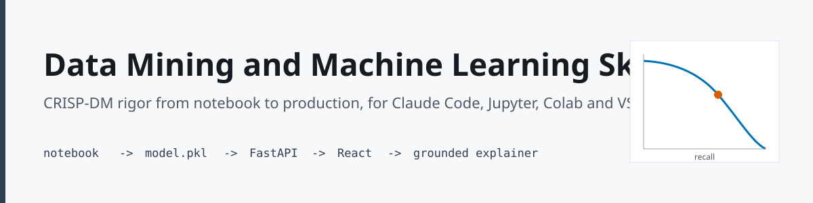
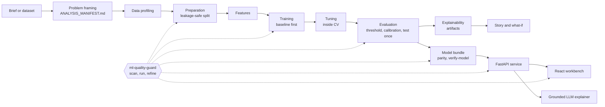
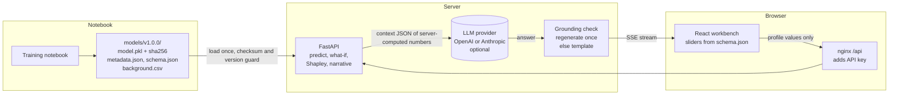

<p align="center">
  
</p>

<h1 align="center">Data Mining and Machine Learning Skill</h1>

<p align="center">A Claude Code plugin that turns Claude into a careful data scientist and ML engineer, from business brief to notebook, trained model, FastAPI service, React what-if workbench and an LLM that explains each prediction without inventing numbers.</p>

<p align="center">
  <a href="LICENSE"></a>
  
  
  
  <br>
  
  
  
  <br>
  
  
  
</p>

## Contents

- [What it does](#what-it-does)
- [Install](#install)
- [Quick start](#quick-start)
- [Skills](#skills)
- [Workflow](#workflow)
- [Architecture](#architecture)
- [Notebook templates](#notebook-templates)
- [Quality gates and the scanner](#quality-gates-and-the-scanner)
- [Repository structure](#repository-structure)
- [Anatomy of a skill](#anatomy-of-a-skill)
- [Token budget](#token-budget)
- [CLI reference](#cli-reference)
- [FAQ](#faq)
- [Contributing](#contributing)
- [Accessibility and inclusion](#accessibility-and-inclusion)
- [License](#license)

## What it does

- **Frames the problem first.** A one-page `ANALYSIS_MANIFEST.md` with the decision, metric, cost of each error, baseline and prevalence before any data is touched.
- **Runs CRISP-DM with rigor.** Leakage-safe pipelines, honest splits (stratified, group-aware, forward-chaining), baselines, intervals on every headline metric, thresholds chosen on validation data, calibration after resampling.
- **Blocks analysis slop and production slop.** An 85-rule catalog; a standard-library scanner detects 79 rules in `.py`, percent files, `.ipynb`, R, SQL, Dockerfiles, prompts, env and front-end files, and a hook feeds errors back to Claude as it edits.
- **Ships the model safely.** A pickle bundle with checksum, metadata, schema and background sample, a fresh-process reload parity check, a version guard and a `verify-model` command.
- **Serves and explains.** A FastAPI service (predict, batch, what-if, Shapley contributions, counterfactuals, streamed narrative), a React workbench designed with Tastemaker, and an RTCC-prompted LLM explainer whose every number is checked against server-computed values.


*The React workbench running against the FastAPI service on simulated data. With no LLM provider configured, the explainer returns the grounded template explanation.*

## Install

| Environment | Install | First step |
|---|---|---|
| Claude Code (terminal or VS Code extension) | `/plugin marketplace add Harrypatria/data-mining-ml` then `/plugin install data-mining-ml@data-mining-ml` | `/data-mining-ml:build <brief or dataset>` |
| Jupyter Notebook 7 | `pip install -e templates` and `pip install -r templates/project/requirements-notebooks.txt` | Open `templates/notebooks/crisp_template.ipynb` |
| JupyterLab 4 | Same as Jupyter; optional `jupytext` for pairing | Edit the paired `.py` or the `.ipynb` |
| Google Colab with Gemini | Use the bootstrap cell below; paste `dist/gemini-colab.md` into the Gemini panel | Click an Open in Colab badge |
| VS Code | Install the recommended extensions (`.vscode/extensions.json`) | Run the task "ml: scan project" |
| Codex, Cursor, Replit, Claude.ai Projects, AI Studio | `python bin/data-mining-ml init --target agents\|cursor\|replit\|claude-project\|ai-studio` | Commit the generated file |

Colab first cell (also in `dist/gemini-colab.md`):

```python
import os, sys, subprocess
IN_COLAB = "google.colab" in sys.modules
SEED = 42
if IN_COLAB:
    subprocess.run([sys.executable, "-m", "pip", "install", "-q", "imbalanced-learn==0.14.2",
                    "git+https://github.com/Harrypatria/data-mining-ml@v1.0.0#subdirectory=templates"], check=True)
    from google.colab import userdata  # keys: userdata.get("OPENAI_API_KEY"); never paste keys into cells
from mlkit.persistence import library_versions
print(library_versions())
```

Optional design layer for the web app: `/plugin marketplace add Harrypatria/tastemaker` then `/plugin install tastemaker@tastemaker`.

## Quick start

```bash
python bin/data-mining-ml init --project churn-risk --package churnkit
cd churn-risk && python -m venv .venv && . .venv/bin/activate
pip install -e . -r requirements-notebooks.txt
python -m nbconvert --to notebook --execute notebooks/03_train_test_save.ipynb --output-dir /tmp/run
python ../bin/data-mining-ml verify-model models
cd api && pip install -r requirements-dev.txt && pytest && cd ..
cp .env.example .env && docker compose up --build        # http://localhost:8080
```

In Claude Code the same path is `/data-mining-ml:build`, then `:train`, `:serve`, `:web` and `:explain`.

## Skills

| Skill | Display name | Use it for |
|---|---|---|
| `data-mining-machine-learning` | Data Mining and Machine Learning Skill (hub) | Routing the whole lifecycle, environments, multi-stack map |
| `problem-framing` | Problem Framing | Brief or PRD to ANALYSIS_MANIFEST.md |
| `data-profiling` | Data Profiling | EDA, distributions, quality, leakage and bias risk, 22 data scenarios |
| `data-preparation` | Data Preparation | Cleaning, joins with row checks, missingness, leakage-safe splits |
| `feature-engineering` | Feature Engineering | Extraction, engineering, selection, feature dictionary, ablation |
| `statistical-analysis` | Statistical Analysis | Tests, A/B experiments, power, corrections, causal caution, time series, survival |
| `data-mining` | Data Mining | Clustering, association rules, anomaly detection, recommenders, text mining |
| `model-training` | Model Training and Saving | Protocol, algorithms, imbalance, pickle bundle, parity, version guard |
| `hyperparameter-tuning` | Hyperparameter Tuning | Random search, halving, Optuna, nested CV, budgets |
| `model-evaluation` | Model Evaluation | Metrics by cost, thresholds, calibration, intervals, slices, fairness |
| `model-explainability` | Model Explainability | Permutation importance, SHAP, ALE, counterfactuals, model card, insights |
| `data-storytelling` | Data Storytelling | SCQA narrative, findings headings, seven ipywidgets panels, export |
| `model-deployment` | Model Deployment | FastAPI, Docker, compose, monitoring, batch, ONNX and PMML |
| `ml-web-application` | ML Web Application | React workbench with Tastemaker, typed client, all UI states |
| `ai-prediction-explainer` | AI Prediction Explainer | RTCC prompt, provider adapter, grounding guard, fallback |
| `ml-quality-guard` | ML Quality Guard | Scanner, Think-Make-Check loop, RIGOR scoring |
| `notebook-audit` | Notebook Audit | Score and fix existing notebooks and repositories |

Commands: `/data-mining-ml:build`, `:audit`, `:scan`, `:fix`, `:train`, `:serve`, `:web`, `:explain`, `:story`, `:report`. Agent: `ml-critic` (fresh-eyes reviewer, read-only).

## Workflow



## Architecture



The browser never holds a provider key, never sends explanation values, and never talks to the LLM directly.

## Notebook templates

All templates run top to bottom on simulated or built-in data, with no downloads. Every number is computed at run time.

| Notebook | Shows | Colab |
|---|---|---|
| `crisp_template.ipynb` | Full CRISP-DM skeleton: framing, profiling, baselines, tuning, threshold, calibration, test once, refit, bundle, explanations, decision summary, artifacts | [](https://colab.research.google.com/github/Harrypatria/data-mining-ml/blob/main/templates/notebooks/crisp_template.ipynb) |
| `imbalance_lab.ipynb` | Accuracy paradox, metrics across prevalence, threshold cost, remedies, recalibration, rare-class intervals, multi-class averages, leakage demo | [](https://colab.research.google.com/github/Harrypatria/data-mining-ml/blob/main/templates/notebooks/imbalance_lab.ipynb) |
| `train_test_save.ipynb` | Protocol, learning curve, `.pkl` bundle, fresh-process parity, version guard | [](https://colab.research.google.com/github/Harrypatria/data-mining-ml/blob/main/templates/notebooks/train_test_save.ipynb) |
| `whatif_dashboard.ipynb` | Seven ipywidgets panels with a static fallback | [](https://colab.research.google.com/github/Harrypatria/data-mining-ml/blob/main/templates/notebooks/whatif_dashboard.ipynb) |
| `story_report.ipynb` | Decision-first SCQA report with computed headings | [](https://colab.research.google.com/github/Harrypatria/data-mining-ml/blob/main/templates/notebooks/story_report.ipynb) |
| `llm_explainer_demo.ipynb` | RTCC explainer, grounding guard, injection attempt, offline template | [](https://colab.research.google.com/github/Harrypatria/data-mining-ml/blob/main/templates/notebooks/llm_explainer_demo.ipynb) |

## Quality gates and the scanner

Every deliverable scores the seven RIGOR gates (Reproducibility, Integrity, Generalization, Explainability, Observability, Communication, Deployability) and ends with one line:

```
Rigor: 0 errors, 1 warning, score 94, RIGOR 7/7, run: passed
```

The catalog has ten families: L leakage, S statistics, M modeling, F features and tuning, X explainability, D data, E engineering, C communication, P production and serving, G generative AI explainer. Escape hatch with a reason: `# ml-ignore M04 threshold fixed by regulator`.

```bash
python scripts/ml_scan.py notebooks/ api/ --imbalanced
```

## Repository structure

```
.claude-plugin/      plugin.json, marketplace.json
.github/workflows/   ci.yml: rule tests, plugin check, notebook execution, API tests, web build
.vscode/             settings, tasks, launch, extensions
adapters/            core-prompt.md and overlays (notebook, jupyterlab, colab, vscode)
agents/              ml-critic.md
assets/              banner and screenshot
bin/                 data-mining-ml CLI (scan, init, prompt, check, notebook-run, verify-model)
commands/            ten slash commands
dist/                generated system, Gemini in Colab, AI Studio and notebook-cell prompts
hooks/hooks.json     PostToolUse scan of edited files
scripts/             ml_scan.py, hook.py, gen_prompts.py, check_budget.py, notebook_tools.py, notebook_run.py, verify_model.py
skills/              17 skills, each SKILL.md plus references/
templates/
  src/mlkit/         shared package: data, transformers, features, metrics, persistence, explain, explainer, narrative, llm, workflow
  notebooks/         six notebooks with paired percent files, percent_template.py
  ml-service/        FastAPI scaffold, tests, Dockerfile
  ml-web/            React, Vite, Tailwind, shadcn/ui scaffold, tests, nginx
  prompts/           rtcc_system.md, rtcc_context.schema.json, rtcc_examples.md
  project/           docker-compose.yml, .env.example, README.md, requirements-notebooks.txt
tests/               rule tests and sloppy and clean fixtures
```

## Anatomy of a skill

```
skills/model-evaluation/
  SKILL.md                         frontmatter (name, trigger-rich description) and a lean body
  references/imbalance-and-metrics.md   loaded only when a step needs it
```

Descriptions open with the plain-language task and list synonyms (machine learning, ML, data science, data mining, predictive modeling, classification, regression, clustering, forecasting, model deployment, explainable AI) so the right skill triggers. Bodies stay under 1,800 tokens; references hold tables and code; scripts execute and are never read into context.

## Token budget

| Tier | Loaded | Size |
|---|---|---|
| Skill descriptions | Always | About 120 to 180 tokens each |
| Skill body | When the skill triggers | 400 to 1,415 tokens (checked under 1,800) |
| References | When a step needs them | 600 to 2,500 tokens each |
| Scripts | Executed, not read | 0 |
| Core platform prompt | Per platform | About 1,240 tokens |

## CLI reference

| Command | Purpose |
|---|---|
| `bin/data-mining-ml scan PATH... [--imbalanced] [--format json] [--fail-on warning]` | Scan for slop; exit 1 on errors |
| `bin/data-mining-ml check` | Verify this repository: JSON, notebooks, pairing, budgets, prompts, fixtures, secrets, style |
| `bin/data-mining-ml prompt TARGET` | Print a generated prompt (system, gemini-colab, ai-studio, notebook-cell, colab, jupyterlab, notebook, vscode, agents, cursor, claude-project, replit) |
| `bin/data-mining-ml init --target NAME [--dir DIR]` | Write platform instructions |
| `bin/data-mining-ml init --project DIR [--package NAME]` | Scaffold notebooks, src, models, artifacts, api, web, compose |
| `bin/data-mining-ml notebook-run NOTEBOOK... [--out DIR]` | Execute from a clean kernel pinned to the current interpreter |
| `bin/data-mining-ml verify-model MODEL_DIR` | Verify a bundle without unpickling |

On Windows use `bin\data-mining-ml.cmd`. Hook mode: `DMML_HOOK_MODE=block|warn|off`.

## FAQ

**Does it need internet access?** No, except package installs you trigger and the optional LLM provider call. With `LLM_PROVIDER=none` the explainer uses a deterministic template built from the same numbers.

**Why pickle, given its risks?** It is the native format for scikit-learn pipelines, so serving runs exactly the training code. The bundle is verified by checksum and library versions before loading, and the API only loads an operator-set path. Use ONNX or PMML for non-Python consumers.

**Can the LLM make up a statistic?** Every number in its answer must match a server-computed value, a percent form or a difference of two values. Otherwise the answer is regenerated once and then replaced with the template.

**Does it work without Tastemaker?** Yes. The web skill asks for it, and if it is missing it applies the same rules and says so.

**Which data does it use?** Templates use simulated data generated at run time (`mlkit.data`). Replace the loader cell with your data and keep the checks.

## Contributing

See [CONTRIBUTING.md](CONTRIBUTING.md). In short: add the catalog row, the scanner rule and a rule test together; edit percent files and regenerate notebooks; edit adapters and regenerate prompts; run `python bin/data-mining-ml check`.

## Accessibility and inclusion

- The web workbench meets WCAG 2.2 AA contrast in light and dark themes (38 token pairs checked), works with a keyboard, labels every slider with its unit and value text, mirrors charts in screen-reader tables, and never uses color as the only signal.
- Charts use the Okabe-Ito colorblind-safe palette with signed numeric labels.
- Docs use plain language, alt text on images and descriptive links, and avoid region-specific idioms.
- Fairness analysis is built into evaluation for people-facing decisions, with the chosen definition stated.

## License

[MIT](LICENSE)
