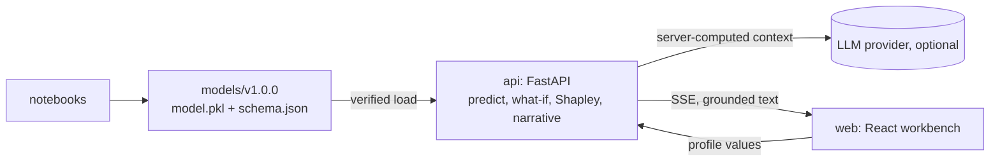

# Project generated by the Data Mining and Machine Learning Skill

Start with `ANALYSIS_MANIFEST.md`: fill in the decision, metric, cost matrix and baseline before running anything.

## Layout

```
notebooks/   01_crisp_end_to_end ... 06_llm_explainer_demo (.ipynb with paired percent .py files)
src/         the project package: transformers, features, metrics, persistence, explanations, explainer
models/      v<semver>/ bundles (model.pkl, model.sha256, metadata.json, schema.json, background.csv, model_card.md) and CURRENT
artifacts/   feature_dictionary.csv, insights.json, data_sheet.md
api/         FastAPI prediction, what-if and explanation service
web/         React what-if workbench
```

## Architecture



## Run

```bash
python -m venv .venv && . .venv/bin/activate          # Windows: .venv\Scripts\activate
pip install -e . -r requirements-notebooks.txt
jupyter lab notebooks/                               # run 03_train_test_save to create models/v1.1.0
cd api && pip install -r requirements-dev.txt && pytest && cd ..
cd api && MODEL_DIR=../models APP_ENV=development uvicorn app.main:create_app --factory --port 8000
cd web && npm ci && npm run dev                      # http://localhost:5173
cp .env.example .env && docker compose up --build     # production-style stack on http://localhost:8080
```

## Rules this project follows

- The test set is scored once; thresholds and calibration come from validation data.
- The pickled pipeline is the only model artifact; it is loaded after a checksum and version check.
- Provider keys live only in `.env` on the server; nginx adds the API key; the browser holds no secrets.
- The explainer describes associations, not causes, and every number it writes is checked.
